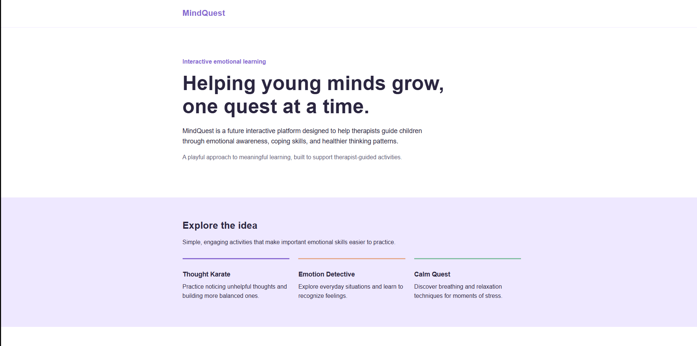

# MindQuest — Interactive Therapy Platform for Children

MindQuest is a web application designed to make emotional learning more engaging and accessible for children through interactive, therapist-guided activities.

The platform aims to help mental health professionals introduce concepts such as emotional awareness, coping strategies, and healthier thinking patterns through games and educational exercises.

**Current Status:** Early Development — Homepage and CRUD API Scaffold

## Project Preview



*MindQuest homepage preview.*

## Planned Features

- **Interactive Activities:** Thought Karate, Emotion Detective, and Calm Quest.
- **Therapist Dashboard:** Manage activities and monitor engagement.
- **Activity Management:** Create, read, update, and delete therapeutic activities.
- **Learner Profiles:** Assign activities to fictional learner profiles.
- **Progress Tracking:** View activity completion and engagement history.
- **Authentication:** Secure therapist registration and login.

These features are planned for future development and are not yet implemented.

## Current Implementation

- Homepage built using EJS and HTML.
- Minimal responsive CSS with a soft color palette.
- Express.js server and MVC project structure.
- RESTful CRUD API routes with placeholder controller functions.
- Commented code to support future development.

## Tech Stack

- **Frontend:** HTML, CSS, EJS
- **Backend:** Node.js, Express.js
- **Architecture:** MVC (Model-View-Controller)
- **Database:** To be integrated in a future development phase

## Getting Started

Clone the repository:

```bash
git clone https://github.com/AnwarAlshohatee/mindquest.git
cd mindquest
```

Install dependencies:

```bash
npm install
```

Start the application:

```bash
npm run dev
```

Visit:

`http://localhost:3003`

## Future Development

- Implement full CRUD functionality with database persistence.
- Develop the interactive Thought Karate activity.
- Add therapist authentication and protected routes.
- Build a therapist dashboard.
- Introduce fictional learner profiles and activity assignments.
- Track activity completion and engagement metrics.

MindQuest currently uses fictional examples and does not collect real patient information. Its planned activities are educational, therapist-guided tools rather than replacements for professional treatment.

## Author

**Anwar Alshohatee** — Software Engineer

[GitHub](https://github.com/AnwarAlshohatee)